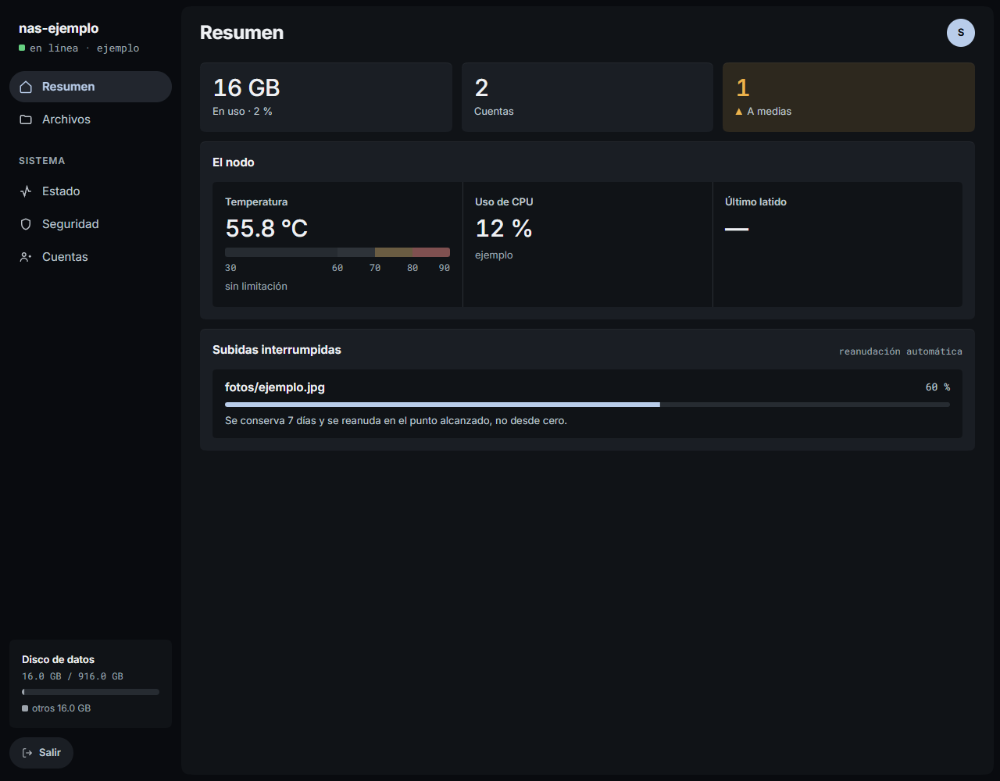
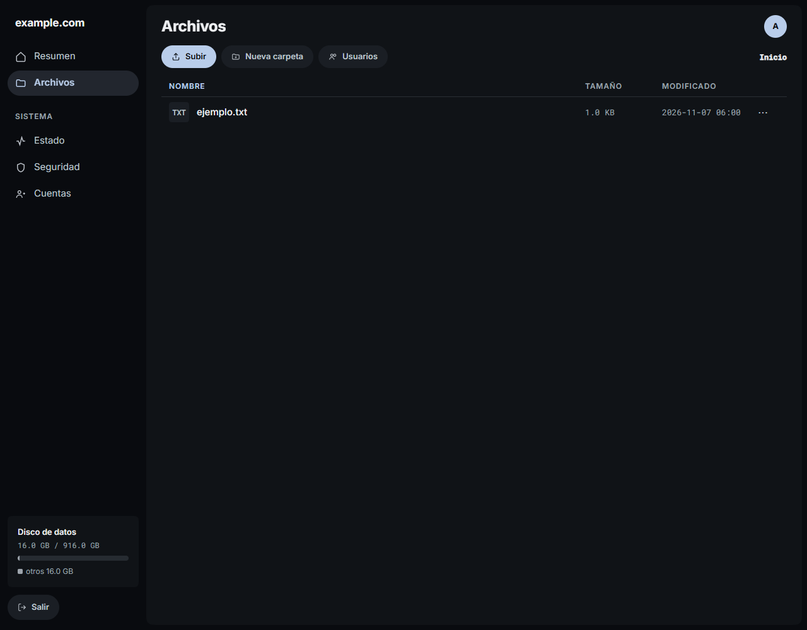
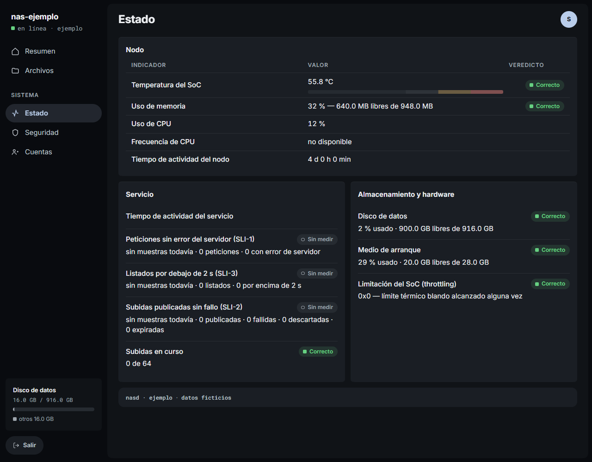
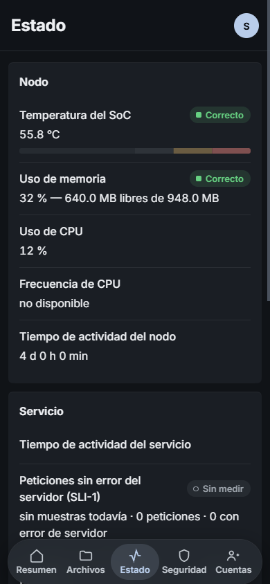
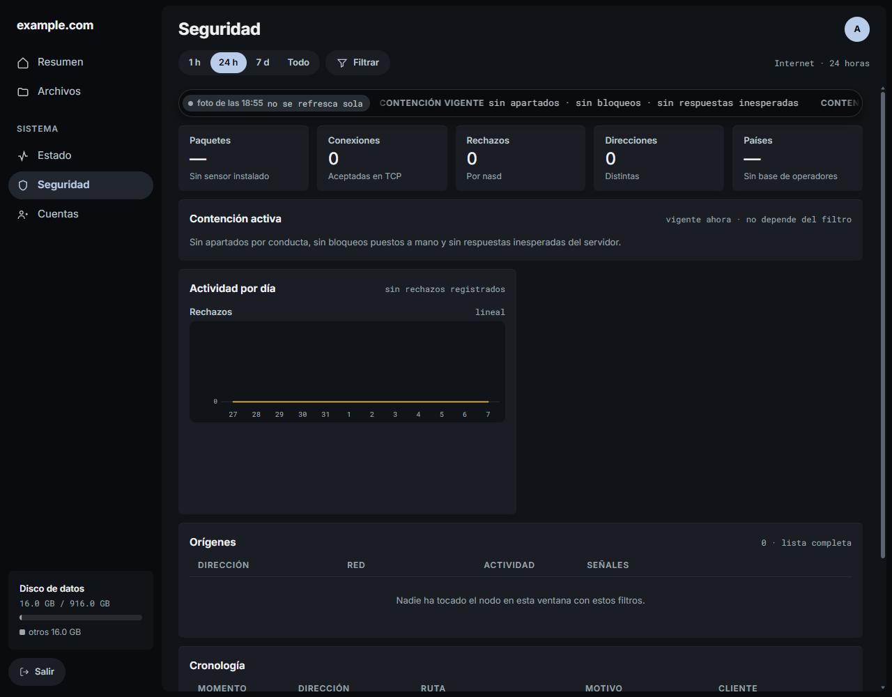
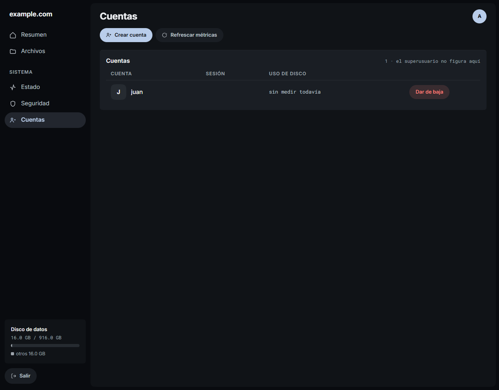

English · [Español](INTERFAZ.md) · [← Back](README.md)

# Current interface

Console v1.134.0, reviewed 2026-11-07. These images render the actual templates
and CSS using fictional test data. They do not show a production node or
prove its health. JavaScript and live updates are disabled for these static
examples. The product is in Spanish and uses locally bundled Inter and Roboto Mono.

## Resumen — overview

Temperature, CPU, storage, accounts and interrupted uploads.

## Archivos — files

A test listing. Available actions depend on the session and network.

## Estado — health

Grouped indicators; unavailable measurements remain unavailable.

390 × 844 CSS pixel Chromium viewport; this is not a Safari device test.

## Seguridad — security

Time filters, containment, activity and origins. This empty example has no
sensor or operator database, so it shows neither country data nor a populated
map. The ribbon explicitly says the snapshot does not refresh.

## Cuentas — accounts

Test accounts. Account administration requires the superuser on LAN or VPN.
Ordinary accounts only have access to Files.

Images must be regenerated when the interface changes. The documentation
exporter is isolated behind the `documentacion` build tag. Screenshots do not
test live streams, uploads, reconnection or recovery. The lightweight
[maintenance policy and priorities](README.es.md#mantenimiento) are maintained in Spanish.
