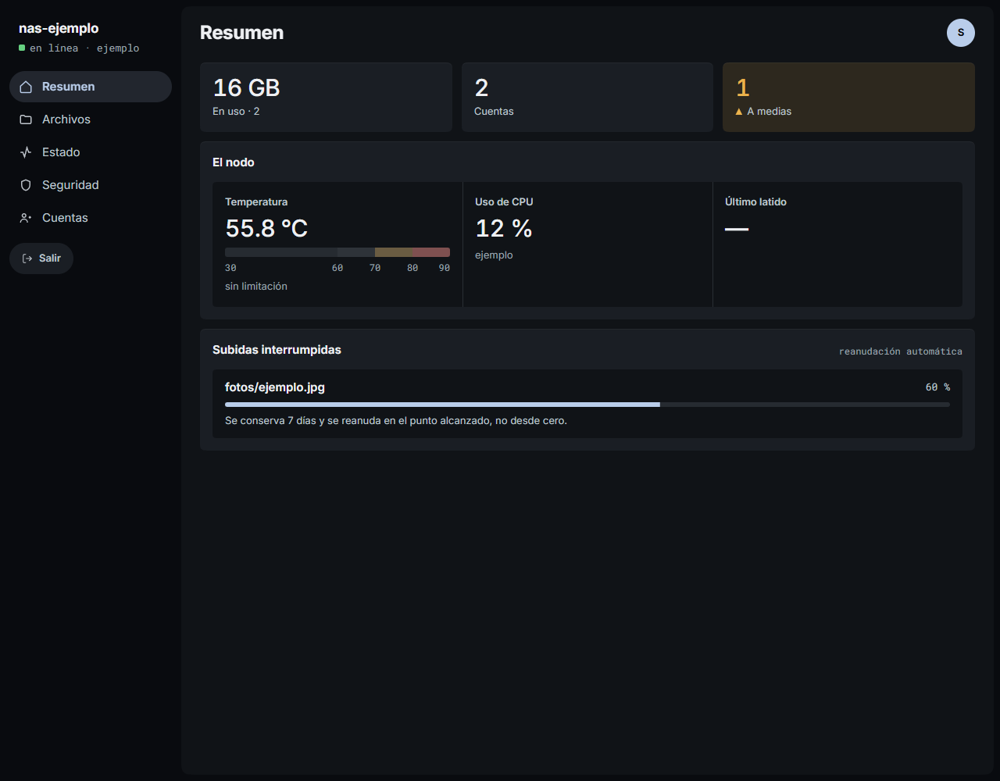
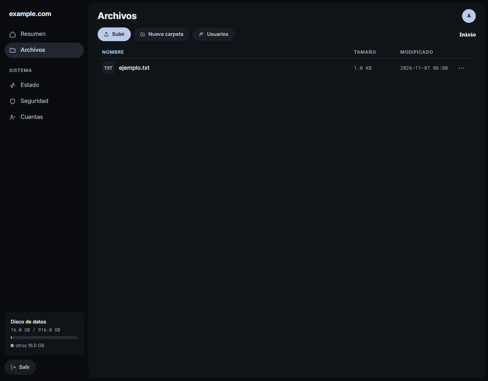
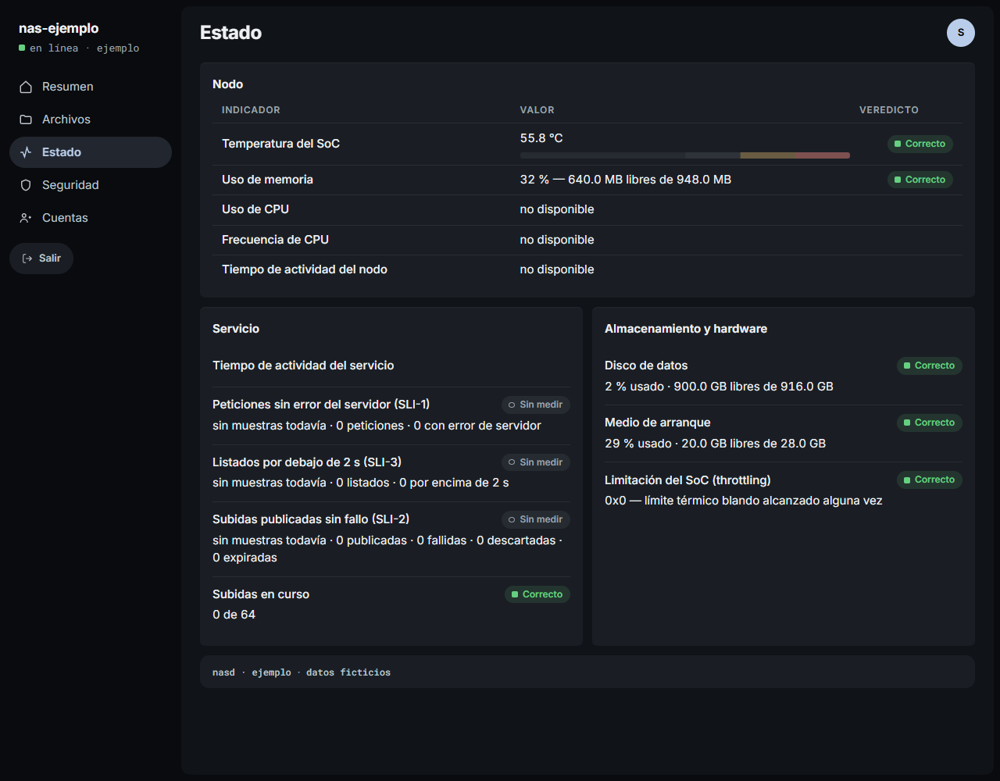
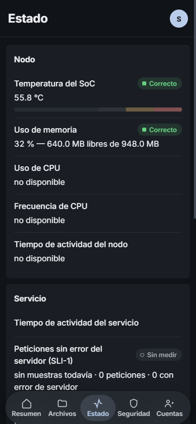
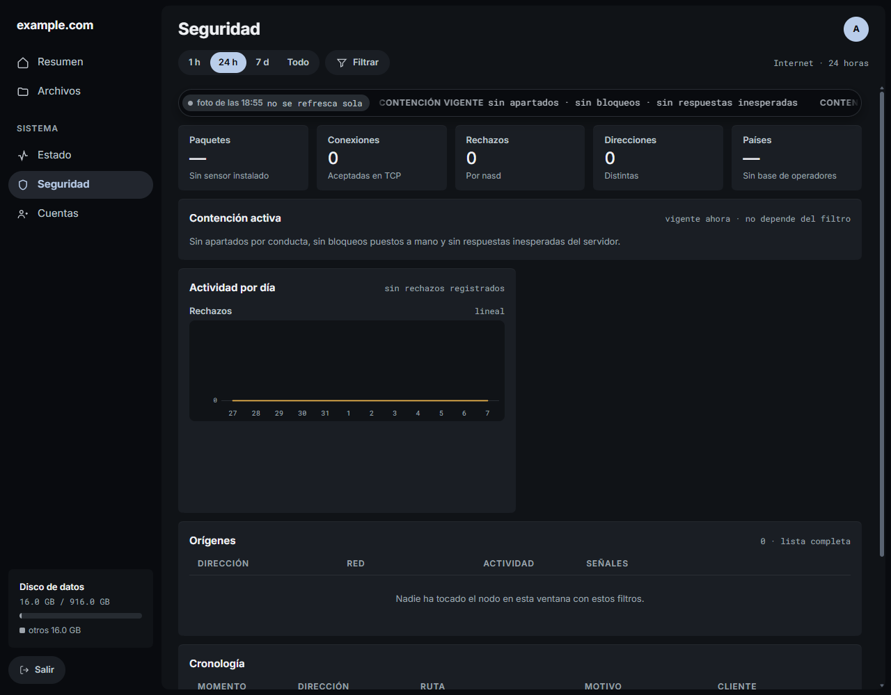
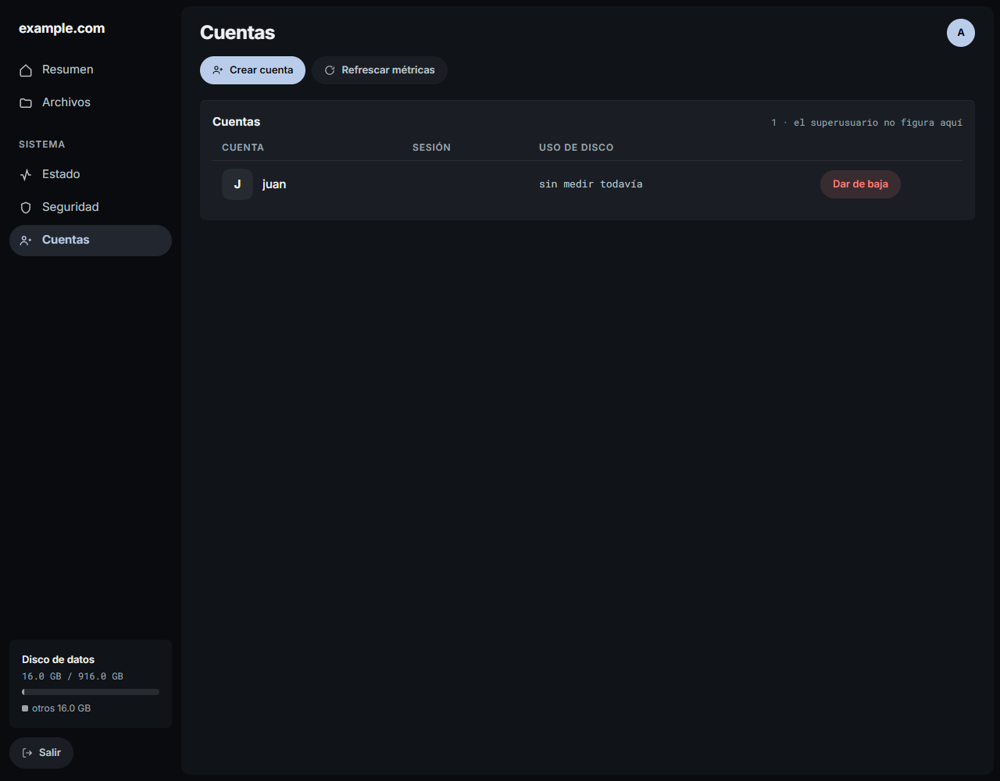

[English](INTERFACE.md) · Español · [← Volver](README.es.md)

# La interfaz actual

Referencia: consola v1.134.0, revisada el 2026-11-07. Capturas de las
plantillas y CSS reales con datos ficticios de pruebas. No proceden del nodo
ni acreditan su salud. Son vistas estáticas: no ejecutan acciones ni el flujo
en vivo. Inter y Roboto Mono se cargan desde los recursos del producto.

## Resumen

Temperatura, CPU, almacenamiento, cuentas y subidas interrumpidas.

## Archivos

Listado de ejemplo; las operaciones disponibles dependen de la sesión y red.

## Estado

Indicadores agrupados en paneles. «No disponible» y «sin muestras» conservan
su significado: no se convierten en ceros ni en señales de éxito.

Vista a 390 × 844 CSS px en Chromium; no sustituye la comprobación en Safari.

## Seguridad

Filtros de tiempo, contención, actividad y orígenes. El ejemplo muestra el
estado vacío, sin sensor ni base de operadores; por eso no presenta países
ni un mapa con actividad inventada. La cinta indica que la foto no se refresca.

## Cuentas

Cuentas de prueba. La administración requiere superusuario desde LAN o túnel;
una cuenta normal solo accede a Archivos.

## Mantener estas imágenes

Se regeneran desde las plantillas del mismo cambio. El exportador documental
está separado del binario mediante la etiqueta de compilación `documentacion`.
Los PNG se revisan antes de publicar; las capturas no prueban SSE, subida,
reconexión ni restauración. Véase [mantenimiento ligero](MANTENIMIENTO.md).
