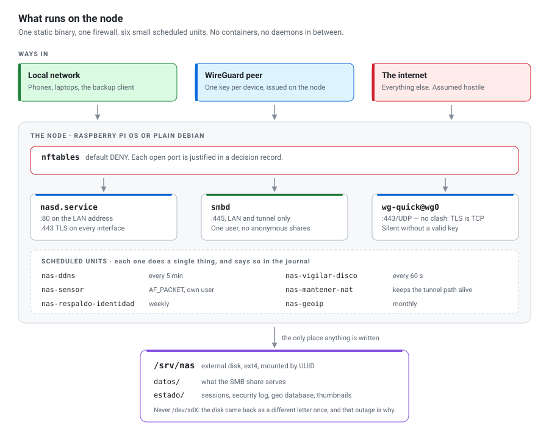
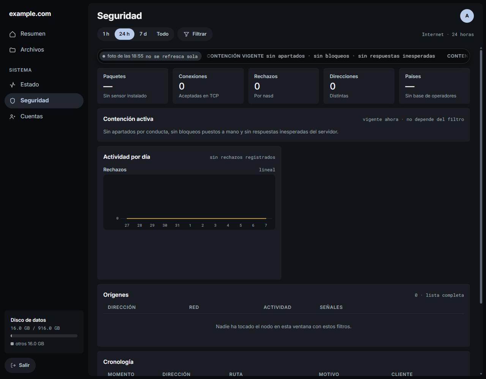
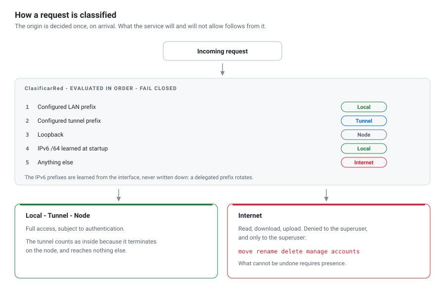
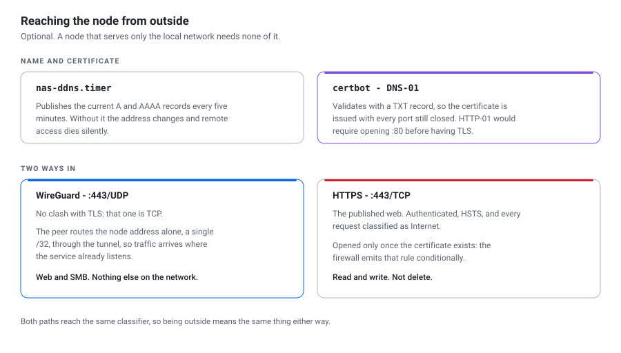

[🇬🇧 English](README.md) · 🇪🇸 Español

# nasd — un NAS autoalojado, escrito desde cero

Un servidor de archivos para un nodo Linux de placa única. Sirve un mismo
almacén por dos vías —SMB y su propia interfaz web— con un panel de control de
acceso y vigilancia encima. Go **sin dependencias externas**, dos auxiliares en C y un cliente de respaldo para Windows en
PowerShell.

En producción desde julio de 2026.

<picture>
  <source media="(prefers-color-scheme: dark)" srcset="nodo-dark.svg">
  
</picture>

<!-- Los diagramas se generan. No los edite a mano. -->

## Componentes

| Ruta | Función |
|---|---|
| `10_CODIGO/cmd/nasd` | El servicio: servidor HTTP/HTTPS, sesiones, almacén, avisos |
| `10_CODIGO/internal/seguridad` | Control de acceso: clasificación del origen, cuarentena, frenos por tasa, anillo de rechazos |
| `10_CODIGO/internal/geoip` | País y operador desde una base binaria que el servicio construye a partir de un TSV público: sin cuenta ni clave de API |
| `10_CODIGO/internal/aviso` | Avisos: convierte cambios de estado en mensajes, con deduplicación y severidad |
| `10_CODIGO/nas-miniatura` | Auxiliar en C que extrae la miniatura EXIF incrustada de un JPEG **sin decodificar la imagen** |
| `10_CODIGO/nas-sensor` | Sensor de paquetes en C (`AF_PACKET`); su mitad de análisis corre con desinfectantes fuera del nodo |
| `20_APROVISIONAMIENTO` | 22 guiones de shell que llevan una instalación limpia del sistema hasta un nodo en marcha |
| `30_CLIENTE_RESPALDO` | Cliente de respaldo para Windows: corridas programadas, copia a disco frío, centinelas antiransomware, indicador en la bandeja |

## La interfaz



El panel de seguridad actual, con datos ficticios y sin eventos. Los otros cuatro
módulos —Resumen, Archivos, Estado y Cuentas— están en
[**La interfaz**](INTERFAZ.md).

## Control de acceso

<picture>
  <source media="(prefers-color-scheme: dark)" srcset="clasificacion-dark.svg">
  
</picture>

La clasificación es de fallo cerrado: una dirección no reconocida se trata como
externa, nunca como interna. Las operaciones que no se deshacen —mover,
renombrar, borrar y administrar cuentas— se le niegan al superusuario desde
Internet, y se niegan en la tabla de rutas y no en la interfaz, de modo que la
página no ofrece un control que el servidor vaya a rechazar.

## Acceso remoto

<picture>
  <source media="(prefers-color-scheme: dark)" srcset="acceso-remoto-dark.svg">
  
</picture>

Las dos vías son opcionales y están apagadas mientras no se configuren. El
cortafuegos emite la regla de TLS solo si existe un certificado, así que nunca
hay un puerto abierto sin nada escuchando detrás.

## Compilación y pruebas

`go.mod` no tiene bloque `require`. El TLS, la capa web, las plantillas, la base
de GeoIP, el mapa del mundo del panel y las métricas están hechos dentro del
árbol o generados fuera de línea e incrustados con `go:embed`. No se descarga
nada en tiempo de ejecución, lo que importa en un nodo cuya razón de ser es
seguir funcionando en la red local cuando no hay internet.

Pruebas de Go, corpus en C bajo desinfectantes de direcciones y de
comportamiento indefinido, y pruebas de PowerShell. La puerta es
`make verificar`: formato, `go vet`, la suite entera y `staticcheck`
**compilado para linux/arm64**, la plataforma del nodo, porque hay diagnósticos
que solo existen ahí. No hay CI: la puerta está en el camino diario.

## Instalación

Seis parámetros y un comando por máquina.

En el nodo, sobre una instalación limpia de Raspberry Pi OS o Debian:

```sh
git clone <este repositorio> && cd nasd/20_APROVISIONAMIENTO
sudo install -d -m 0755 /etc/nas
sudo cp ajustes.conf.ejemplo /etc/nas/ajustes.conf
sudo nano /etc/nas/ajustes.conf
sudo ./instalar.sh
```

En la estación de trabajo Windows, para el cliente de respaldo:

```powershell
cd 30_CLIENTE_RESPALDO
.\Instalar.ps1 -Nodo [IPv4-LAN]
```

`instalar.sh` invoca los 22 guiones en orden y se detiene en cuanto uno falla.
Antes de modificar el nodo verifica cada condición que, de fallar a mitad,
dejaría el disco formateado y el servicio a medio instalar, y las reporta todas
a la vez. Los detalles están en
[`20_APROVISIONAMIENTO/LEEME.md`](20_APROVISIONAMIENTO/LEEME.md) y en
[`10_CODIGO/LEEME.md`](10_CODIGO/LEEME.md).

## Configuración

Seis parámetros en `/etc/nas/ajustes.conf`: red local, dirección del nodo,
interfaz, disco de datos, modelo del disco y rango del túnel. Ninguno está
escrito en el código.

Se declaran, no se detectan. Deducir la red a partir de la interfaz acierta
casi siempre, y la excepción —una segunda interfaz, un enlace Wi-Fi activo, una
concesión DHCP sin asentar— produce una deducción plausible y errónea, que es
el modo de fallo que este diseño evita: no se rompe nada, y todo el tráfico
local queda clasificado como externo. El servicio deriva su red local de la
dirección a la que se enlaza, de modo que el valor por omisión corresponde a la
instalación.

## Registros de decisión

El código cita decisiones —`ADR-0044`, `RF-30`, `§7`, y unas 1.600 más— que
resuelven a un archivo de diseño que se mantiene **privado**: un charter, los
requisitos y 96 registros de decisión de arquitectura con lo que se eligió y lo
que se descartó.

No se publican: describen una instalación concreta con detalle operativo. El
código conserva una densidad de comentario alta y casi todas las decisiones
están narradas en el archivo donde se aplican, así que las citas son en su
mayoría redundantes con el texto que tienen al lado. Aun así no resuelven a
nada que se pueda abrir, y omitirlo sería peor que declararlo.

## Requisitos

- Una Raspberry Pi 3B+ o superior, con Raspberry Pi OS o Debian, y un disco
  externo
- **Go 1.25.** Si el nodo lo tiene, el instalador compila ahí; si no, se detiene
  e imprime el comando exacto para compilar en otra máquina y enviar el
  resultado por `scp`. Una 3B+ con 512 MB cae en el segundo caso, como se
  espera
- `zig cc`, **solo** para los dos auxiliares en C, que son opcionales

## Licencia

**Todos los derechos reservados. No se concede ninguna licencia.**

Este repositorio se publica para ser leído, no para ser reutilizado. Que no haya
archivo de licencia es una decisión, no un descuido.

### Material de terceros

La interfaz web incrusta dos tipografías, **Inter** y **Roboto Mono**, como
subconjuntos `.woff2` en `internal/adaptadores/web/estatico/`. No son mías y la
línea de arriba no las cubre: provienen de Google Fonts bajo la **SIL Open Font
License 1.1**, que es la que rige su uso, y su copyright pertenece a sus
autores. El texto de la licencia está en [`OFL.txt`](OFL.txt).

## Mantenimiento

Referencia revisada: consola v1.134.0, 2026-11-07. El historial queda en Git;
las instrucciones se actualizan aquí y en la guía de interfaz existente.

1. Describir el problema observable y el resultado que permitirá cerrarlo.
2. Hacer un cambio acotado; refactorizar cuando reduzca un coste concreto.
3. Verificar según el riesgo: `cd 10_CODIGO && make verificar` para el servicio;
   añadir `-race` en Linux/WSL si cambia concurrencia. En interfaz, comprobar
   escritorio, móvil, teclado, error, desconexión y permisos del servidor.
4. Actualizar solo la explicación y las capturas afectadas. En el commit/PR
   dejar problema, cambio, comprobación y límite; sin repetirlo en varios archivos.
5. Publicar la copia filtrada y comprobar la revisión remota. El despliegue
   es una acción separada. Un cambio documental no incrementa la versión del servicio.

**ADR solo para hitos:** arquitectura, durabilidad, límites de confianza,
contratos públicos o dependencias difíciles de retirar. Una página con contexto,
decisión, alternativa importante y consecuencias. Correcciones y ajustes visuales
se explican en el commit/PR; si sustituyen una decisión, identificar el ADR afectado.

**Pendiente de priorizar con el responsable:** regresiones de conexión SSE,
desplazamiento móvil y foco; restauración de una muestra de respaldo en destino
aislado; CI sobre la copia pública. Son propuestas, no fallos demostrados ni
trabajo iniciado. La nota de Seguridad sigue pendiente de acordar.

Las [capturas](INTERFAZ.md) muestran plantillas reales con datos ficticios.
No prueban Safari real, SSE, restauración ni salud de producción. Las mediciones
operativas deben llevar fecha; no copiarse como un estado permanentemente vigente.

El método adapta [DORA: calidad documental](https://dora.dev/capabilities/documentation-quality/)
y [lotes pequeños](https://dora.dev/capabilities/working-in-small-batches/),
[Software Engineering at Google, capítulo 10](https://abseil.io/resources/swe-book/html/ch10.html)
y el estudio de [Bacchelli y Bird, ICSE 2013, Microsoft Research](https://www.microsoft.com/en-us/research/publication/expectations-outcomes-and-challenges-of-modern-code-review/).
Sustentan claridad, documentación junto al código y revisión de cambios acotados;
no certifican ausencia de fallos. Referencias consultadas el 2026-11-07.
