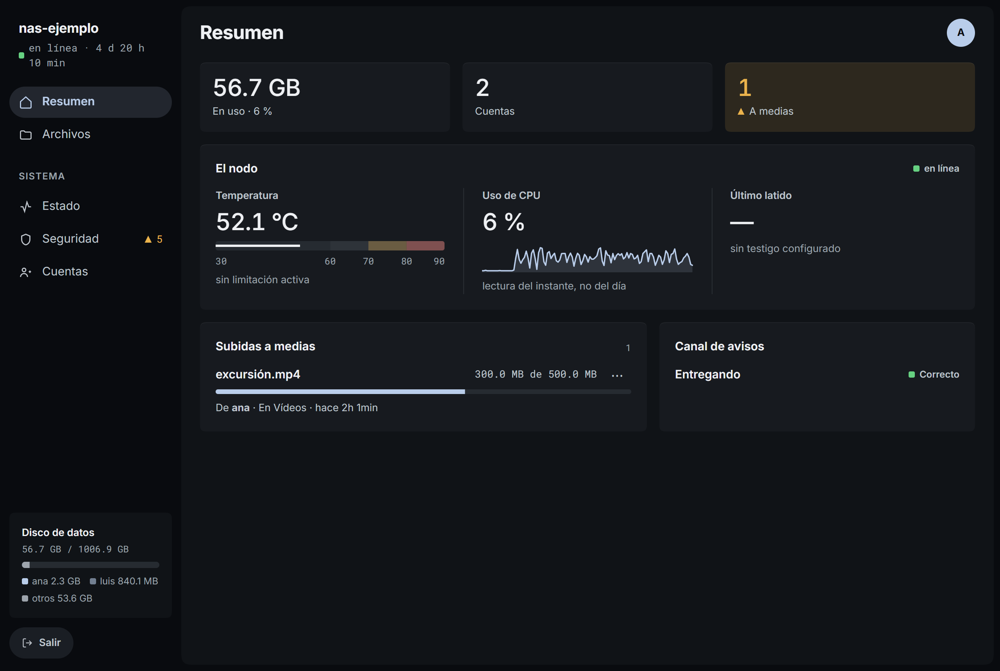
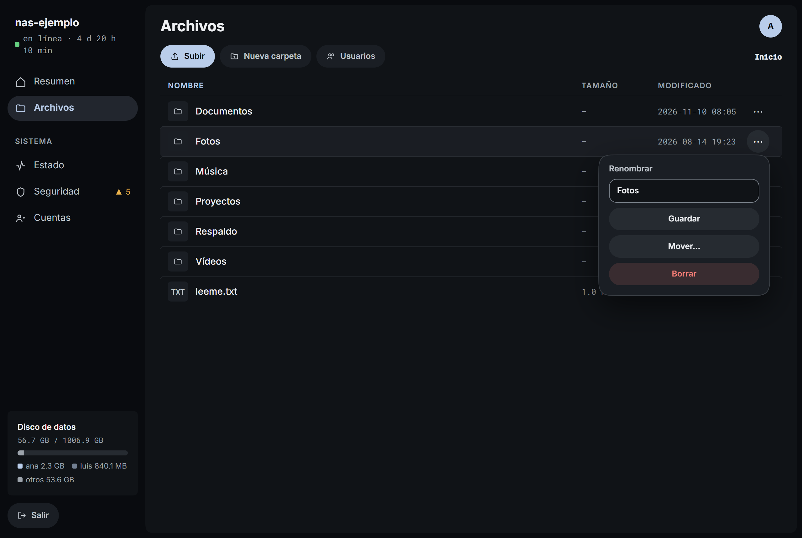
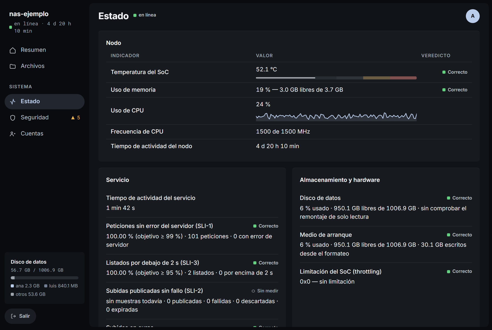
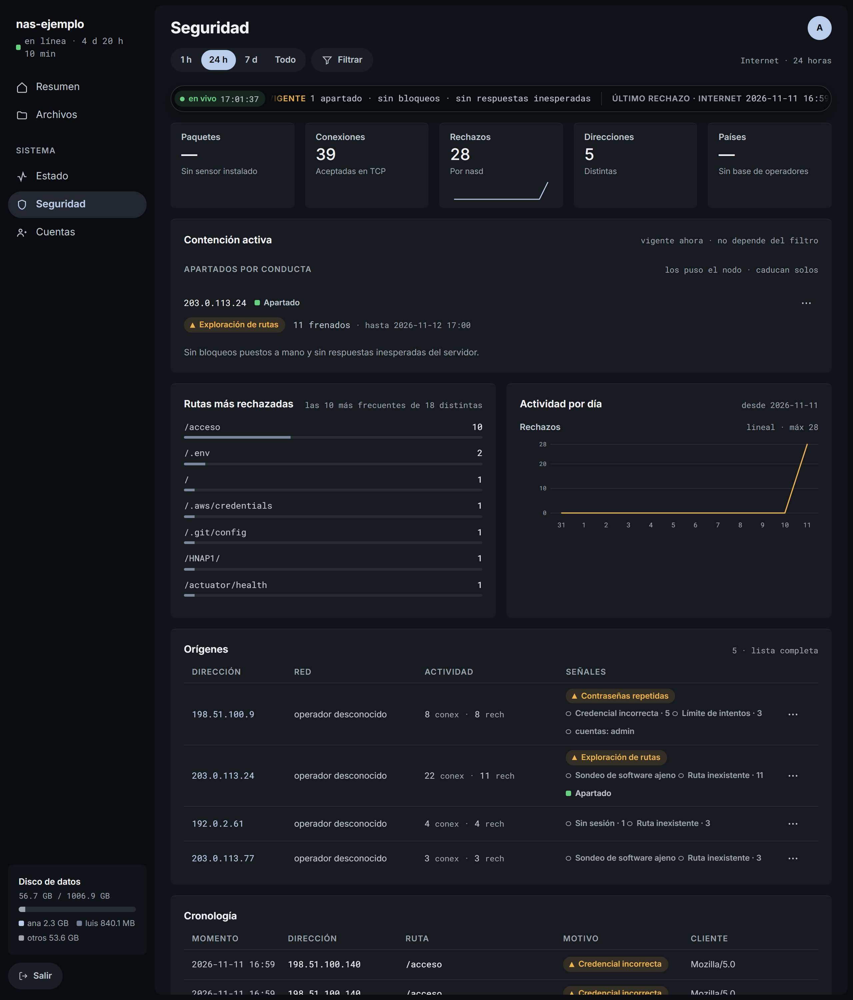
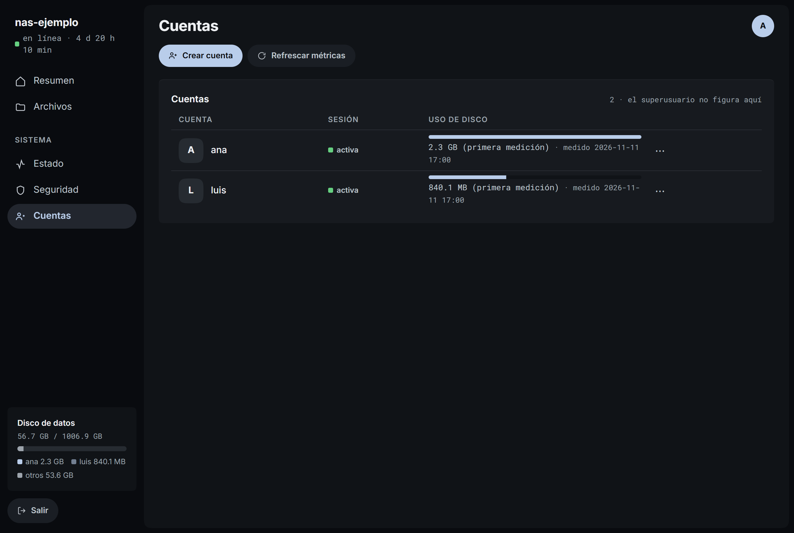
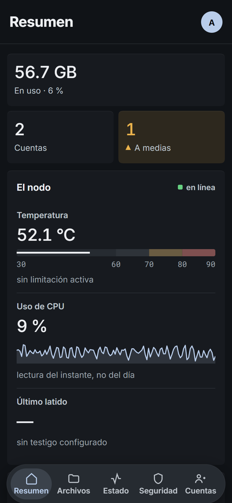
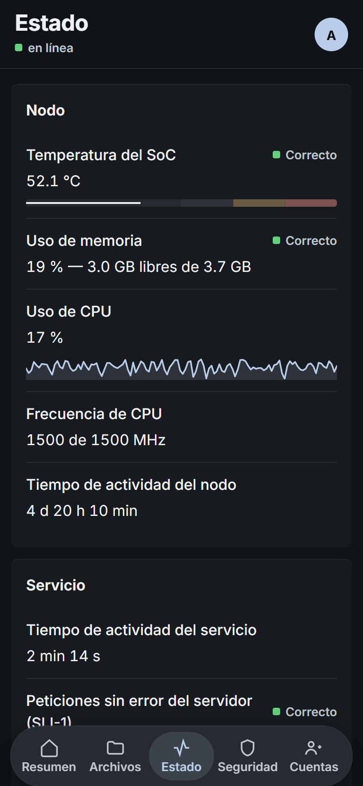
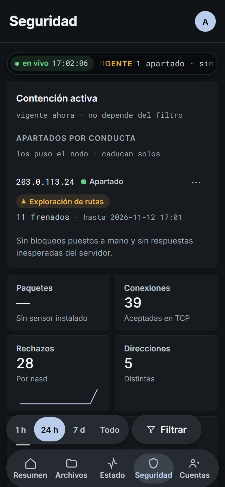

English · [Español](INTERFAZ.md) · [← Back](../README.md)

# The interface

Console v1.138.0, captured on 2026-11-11 on a lab node: the real binary, with
its JavaScript and live stream, over a test volume. Everything shown is
fictional: files, accounts, hardware readings and visits, which come from
documentation addresses (RFC 5737). Nothing here comes from the production node
or proves its health. The product is in Spanish.

## Resumen — overview

Temperature, CPU, heartbeat, interrupted uploads and the alert channel. The
footer of the menu splits the disk by account.

## Archivos — files

Every item has its ⋯ menu. Rename, move and delete are offered only from the
LAN or the tunnel.

## Estado — health

Indicators with their verdict. "Not available" and "not measured" keep their
meaning: they never turn into zeros or into signs of success.

## Seguridad — security

Live ribbon, current containment, most rejected paths, daily activity, origins
and timeline. The lab has no packet sensor and no operator database, so there
are no countries and no map.

## Cuentas — accounts

Create, remove from the ⋯ menu, and disk usage measured on request. Account
administration requires the superuser on the LAN or the tunnel; an ordinary
account only sees Files.

## On a phone

The modules move to a bar at the bottom and the panels stack. A 390 × 844
Chromium viewport: not a substitute for testing on Safari.

  
  
  

The screenshots are redone whenever the interface changes. They do not test
uploads, reconnection or recovery. The lightweight
[maintenance policy](../README.es.md#mantenimiento) is kept in Spanish.
