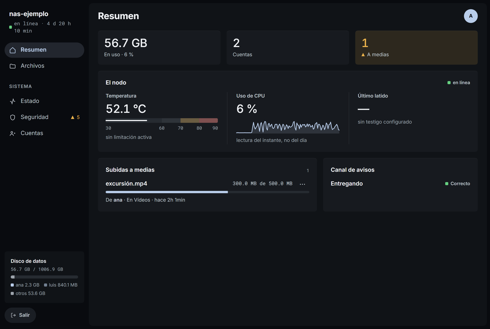
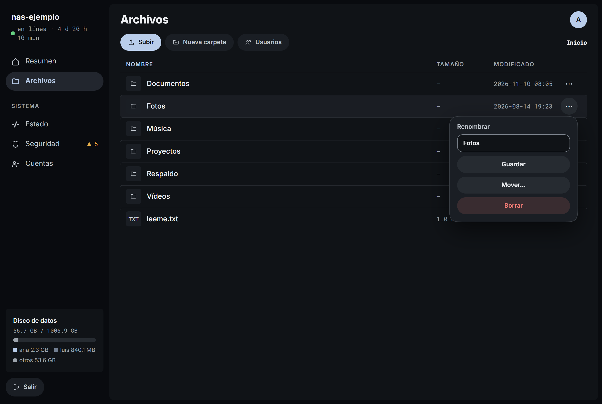
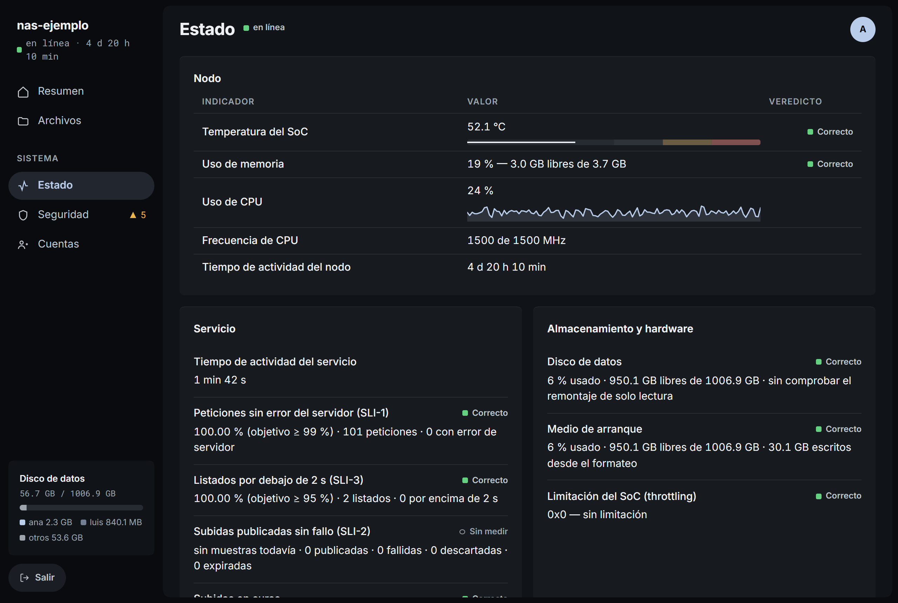
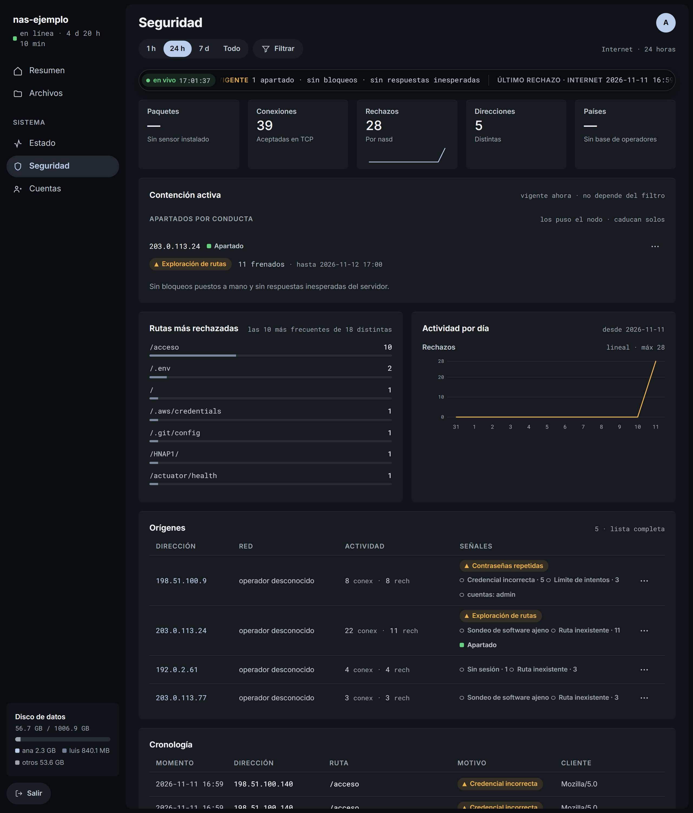
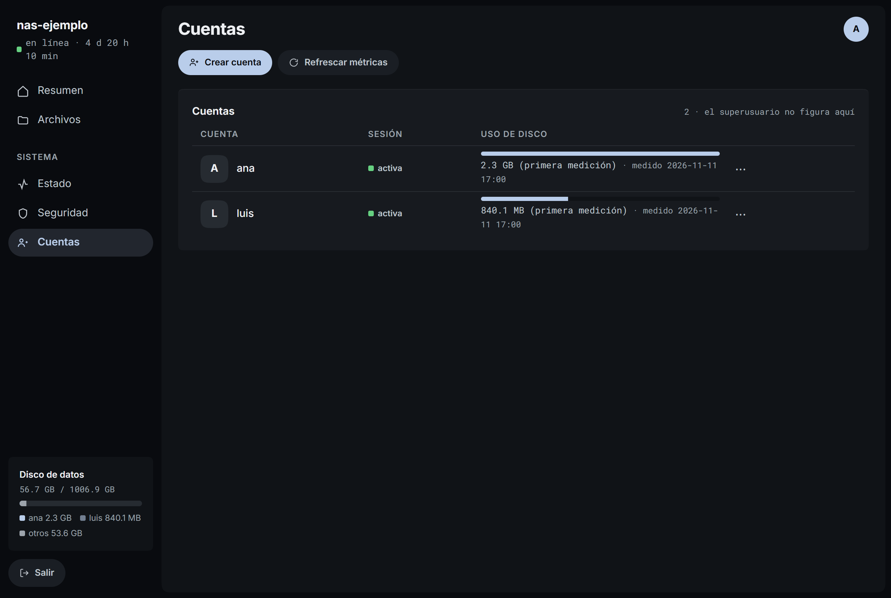
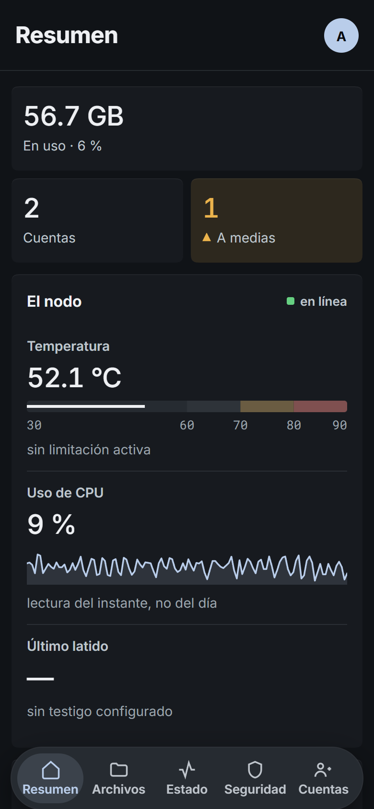
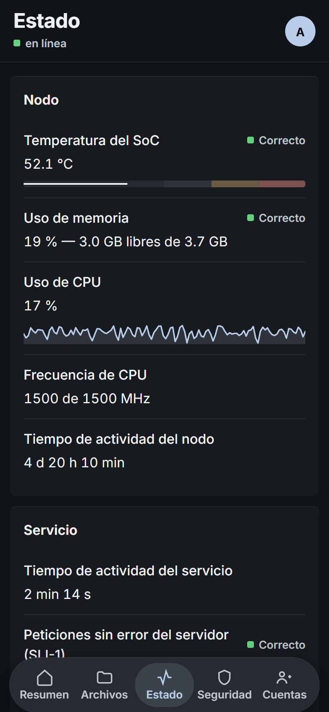
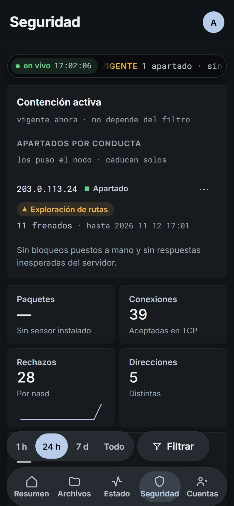

[English](INTERFACE.md) · Español · [← Volver](../README.es.md)

# La interfaz

Consola v1.138.0, capturada el 2026-11-11 en un nodo de laboratorio: el
binario real, con su JavaScript y el flujo en vivo, sobre un volumen de prueba.
Todo lo que se ve es ficticio: archivos, cuentas, lecturas de hardware y
visitas, que salen de direcciones de documentación (RFC 5737). No procede del
nodo en producción ni acredita su salud.

## Resumen

Temperatura, CPU, latido, subidas a medias y canal de avisos. El pie del menú
reparte el disco por cuenta.

## Archivos

Cada elemento tiene su menú ⋯. Renombrar, mover y borrar solo se ofrecen desde
la LAN o el túnel.

## Estado

Indicadores con su veredicto. «No disponible» y «Sin medir» conservan su
significado: no se convierten en ceros ni en señales de éxito.

## Seguridad

Cinta en vivo, contención vigente, rutas más rechazadas, actividad por día,
orígenes y cronología. El laboratorio no tiene sensor de paquetes ni base de
operadores, así que no hay países ni mapa.

## Cuentas

Alta, baja en el menú ⋯ y uso de disco medido a petición. La administración
exige superusuario desde la LAN o el túnel; una cuenta normal solo ve Archivos.

## En el teléfono

Los módulos bajan a una barra al pie y los cuadros se apilan. Vista de
390 × 844 en Chromium: no sustituye la prueba en Safari.

  
  
  

Las capturas se rehacen cuando cambia la interfaz. No prueban subidas,
reconexión ni restauración. Véase [mantenimiento](../README.es.md#mantenimiento).
